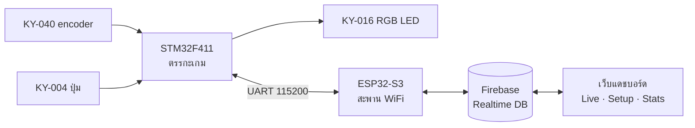

# ส่วนที่ 1 — ภาพรวมโปรเจกต์

Oct 23, 2026 · @Naraya

> Board Game Turn Timer · [1. ภาพรวม](01-overview.md) · [2. การต่อบอร์ดและการตั้งค่า](02-hardware-setup.md) · [3. การแบ่งงานและแผน](03-team-plan.md)

## แนวคิด

กล่องจับเวลาวางกลางโต๊ะบอร์ดเกม: หมุน encoder ตั้งเวลาต่อเทิร์น กดปุ่มเพื่อจบเทิร์น ไฟ RGB บอกเวลาที่เหลือ และส่งสถิติการเล่นขึ้นคลาวด์ให้ดูผ่านเว็บ

**ปัญหาที่แก้:** เกมยืดเพราะบางคนคิดนาน และไม่มีใครรู้ว่าใครใช้เวลาเท่าไร

**ฮาร์ดแวร์หลัก:** NUCLEO-F411RE (STM32F411RE) + ESP32-S3 (NodeMCU)

| ข้อกำหนดของวิชา | ตอบโจทย์อย่างไร |
| --- | --- |
| STM32 ↔ NodeMCU สื่อสารและมีการประมวลผล | STM32 นับเวลา คุม state machine ตัดสินสี LED คำนวณเวลาที่ใช้/เกินเวลา แล้วส่งผ่าน UART ให้ ESP32 |
| เซนเซอร์/แอคชูเอเตอร์ 3 ประเภท | Rotary encoder KY-040 (อินพุตหมุน), Key switch KY-004 (อินพุตปุ่ม), RGB LED KY-016 (เอาต์พุตแสง) |
| เชื่อมอินเทอร์เน็ตและคลาวด์ | ESP32-S3 ส่งข้อมูลขึ้น Firebase Realtime Database (หรือ NETPIE) และรับคำสั่งกลับจากเว็บ |

- [ ] ถาม TA/อาจารย์ว่า encoder + ปุ่ม นับเป็น 2 ประเภทหรือไม่ (ถ้าไม่นับ ต้องเพิ่มโมดูลที่สี่ ดู[ตารางความเสี่ยง](03-team-plan.md#35-ความเสี่ยงและแผนสำรอง))

## พฤติกรรมของเครื่อง

เครื่องมี 5 สถานะ: SETUP → (READY) → RUN ⇄ PAUSE → OVER โดย READY คือได้ค่าตั้งจากเว็บแล้วรอกดเริ่ม (ผัง state machine เต็มอยู่ใน [docs/architecture.md](docs/architecture.md#4-stm32-state-machine))

| การกระทำ | SETUP | RUNNING | PAUSED |
| --- | --- | --- | --- |
| หมุน encoder | เปลี่ยนค่าที่เลือก (จำนวนผู้เล่น 2–6 / เวลาต่อเทิร์น 10–300 วินาที ทีละ 5) | ไม่มีผล | ไม่มีผล |
| กดปุ่มบน encoder (SW) | ยืนยันค่า ไปค่าถัดไป / เริ่มเกม | หยุดชั่วคราว | เล่นต่อ |
| กดปุ่ม KY-004 | — | จบเทิร์น ส่งต่อคนถัดไป | — |
| กดค้าง KY-004 ≥ 2 วินาที | — | จบเกม | จบเกม |

**ความหมายของสีไฟ**

| สถานะ / เวลาที่เหลือ | สี LED |
| --- | --- |
| มากกว่า 30% | เขียว |
| 10–30% | เหลือง (R+G ผ่าน PWM) |
| น้อยกว่า 10% | แดง |
| เกินเวลา | แดงกะพริบ 2 Hz |
| PAUSED | น้ำเงินหายใจ (fade เข้า-ออก) |
| SETUP | น้ำเงินค้าง, กะพริบหนึ่งครั้งทุกครั้งที่หมุน |

**เมื่อจบแต่ละเทิร์น** STM32 ส่งข้อมูล: ผู้เล่นคนไหน ใช้เวลากี่มิลลิวินาที และเกินเวลาหรือไม่ เวลาไม่หยุดเมื่อหมด แต่นับต่อเป็นเวลาเกิน (overtime) เพื่อเก็บสถิติ

ค่าตั้งต้นทั้งหมดตั้งจากเว็บได้ด้วย ถ้าตั้งจากเว็บ เครื่องจะข้าม SETUP ไปรอกดเริ่มเลย

## ผังระบบ

รายละเอียดการไหลของข้อมูล การจัดการเน็ตหลุด และเหตุผลของการออกแบบ: [docs/architecture.md](docs/architecture.md)

| ส่วน | หน้าที่ |
| --- | --- |
| STM32 (Nucleo) | ตรรกะของเกมทั้งหมด: อ่านอินพุต, state machine, นับเวลา, คุม LED, ส่งข้อความ UART |
| ESP32-S3 | สะพาน: แปลงข้อความ UART เป็นข้อมูลบนคลาวด์ และส่งคำสั่งจากเว็บกลับมา |
| Firebase | เก็บสถานะเครื่อง, ค่าตั้ง, คำสั่ง และประวัติทุกเกม |
| เว็บแดชบอร์ด | ดูสด ตั้งค่า และดูสถิติจากมือถือ |

ถ้าเน็ตหลุด เครื่องยังเล่นต่อได้

## เว็บแดชบอร์ด

เว็บหน้าเดียว 3 แท็บ ฟังข้อมูลจาก Firebase แบบ real-time เปิดจากมือถือได้ตอนเดโม

| หน้า | แสดงอะไร | ทำอะไรได้ |
| --- | --- | --- |
| Live | ชื่อผู้เล่นที่กำลังเล่น ตัวเลขนับถอยหลังตัวใหญ่ วงแหวนสีตรงกับ LED ลำดับผู้เล่นถัดไป สถานะออนไลน์ของเครื่อง | Pause / Resume / Reset |
| Setup | ฟอร์มชื่อผู้เล่น จำนวนคน เวลาต่อเทิร์น | บันทึกลง `/device/config` แล้วเครื่องอัปเดตตาม |
| Stats | เวลาเฉลี่ยต่อเทิร์นของแต่ละคน (bar chart), เวลาต่อเทิร์นตลอดเกม (line chart), จำนวนครั้งที่เกินเวลา, เทิร์นที่นานที่สุด, ประวัติเกมย้อนหลัง | เลือกดูเกมเก่า |

