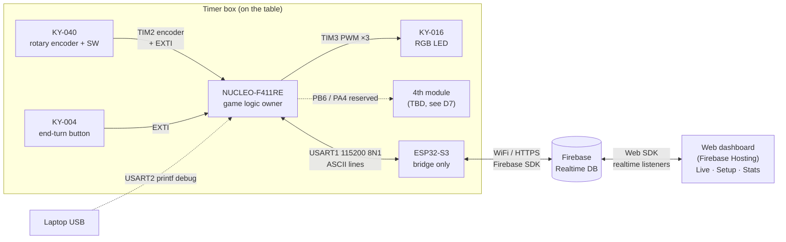
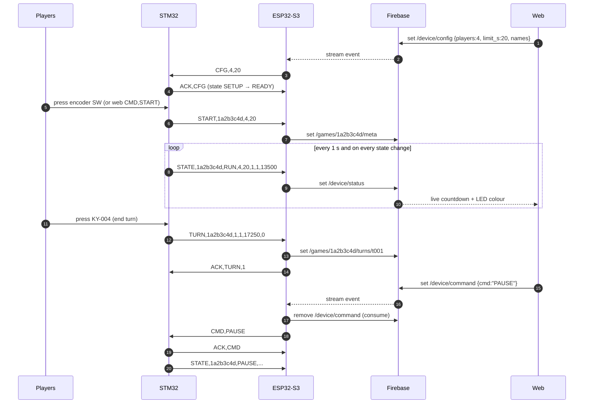
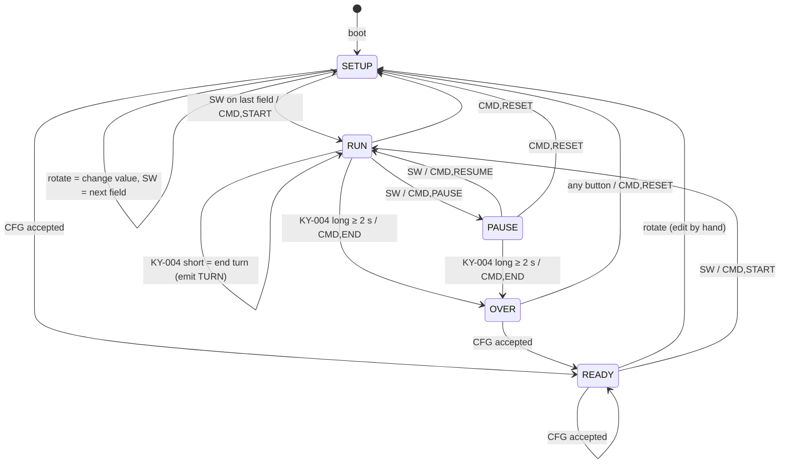

# System Architecture — Board Game Turn Timer

Owner: System Architect (Chikawa / Boeing) · Status: **v1.0 draft — lock at the Wednesday team meeting**

The Thai docs describe *what* we build ([01 overview](../01-overview.md)), *how it's wired*
([02 hardware](../02-hardware-setup.md)) and *who does what when* ([03 plan](../03-team-plan.md)).
This file covers *how the parts fit together*: responsibilities, data flow, the state machine and failure
handling. The interface contracts below replace the first-draft protocol/data tables that used to be in 02 §2.4–2.5;
what changed is listed at the bottom.

Related contracts:

| Doc | Contract between | Owner |
| --- | --- | --- |
| [`02-hardware-setup.md`](../02-hardware-setup.md) | Wiring ↔ STM32 firmware | LEAD + EMB |
| [`protocol.md`](protocol.md) | STM32 ↔ ESP32 (UART) | LEAD + EMB + NET |
| [`cloud.md`](cloud.md) | ESP32 ↔ Firebase ↔ Web | LEAD + NET + WEB |
| [`test-checklist.md`](test-checklist.md) | Everyone ↔ the demo | LEAD |

---

## 1. Block diagram



## 2. Responsibility split (the one rule that keeps the system simple)

| Layer | Owns | Must NOT do |
| --- | --- | --- |
| **STM32** | All game rules and timing: state machine, turn timing, pause accounting, overtime, LED behaviour, `game_id` | Know wall-clock time, player names, or anything about the internet |
| **ESP32-S3** | Translating UART lines ↔ Firebase, WiFi/NTP, offline queue, timestamps | Make game decisions. If it has to "think" about the game, the logic belongs on the STM32 |
| **Firebase** | Storage + realtime fan-out | Business logic (no Cloud Functions needed) |
| **Web** | Presentation, player names, statistics (computed client-side from raw turns) | Be required for the game to run |

Consequences:

- **The box is fully playable with no WiFi.** Cloud is an enhancement, never a dependency.
- **Raw data goes up, statistics are computed on the web.** We store each turn's `duration_ms` and
  `overtime_ms`; averages, medians, titles etc. are derived. Changing a stat never needs a re-flash.
- **Every message and every DB write is idempotent.** Duplicates and replays are harmless (see §6).

## 3. Data flow



## 4. STM32 state machine



Protocol state names: `SETUP`, `READY`, `RUN`, `PAUSE`, `OVER`.

Rules:

1. **Ending a game** (long press or `CMD,END`) first emits a `TURN` for the turn in progress, then
   `END,<id>,<turns>,USER`. `CMD,RESET` during a game emits `END,<id>,<turns>,RESET` *without* a final
   `TURN` (aborted turn is discarded).
2. **Short vs long press on KY-004** is decided on release (< 2000 ms = short) or when the 2000 ms
   mark is reached while still held (= long, fires immediately). The **turn end time is taken at the
   press edge**, not the release, so the measurement is accurate.
3. **Turn-end lockout:** ignore KY-004 presses for 300 ms after a turn ends (stops double-skips).
4. **Encoder rotation is ignored** in `RUN`, `PAUSE`, `OVER`.
5. `CFG` is accepted only in `SETUP`, `READY`, `OVER`; otherwise reply `ERR,CFG,BUSY`.

### Turn timing model (all in `HAL_GetTick()` ms, unsigned subtraction)

```
elapsed_ms   = (now - turn_start) - paused_total     // paused_total resets each turn
remaining_ms = limit_s*1000 - elapsed_ms              // signed; negative = overtime
overtime_ms  = max(0, elapsed_ms - limit_s*1000)
duration_ms  = elapsed_ms (at the press edge)
```

The clock never stops at zero — it keeps counting into overtime so stats are honest.

### LED mapping (computed from `remaining_ms / (limit_s*1000)`)

Same colours as [01 overview](../01-overview.md); this adds the READY, OVER and link-down cases.

| Condition | LED |
| --- | --- |
| SETUP | solid blue, one blink per encoder detent |
| READY | slow blue pulse (1 Hz) |
| RUN, > 30 % left | green |
| RUN, 10–30 % | yellow (R+G) |
| RUN, < 10 % | red |
| RUN, overtime | red blinking 2 Hz |
| PAUSE | blue breathing (fade) |
| OVER | white for 3 s, then off |
| Bridge/WiFi down (any state) | one short magenta flash every 5 s overlaid |

If a 4th module is added (D7), its behaviour is defined here in the same PR.

## 5. Firmware & software structure

### STM32 (STM32CubeIDE + HAL) — non-blocking super-loop, ISRs only set flags

CubeMX settings and the module split are in [02 §2.3](../02-hardware-setup.md). Additions: `link_service()` for the
heartbeat/retransmit/timeout timers, and `link.c` uses the shared `common/proto.c` instead of its own parser.

```c
while (1) {
    uint32_t now = HAL_GetTick();
    input_poll(now);          // EXTI flags + TIM2 count -> events: BTN_SHORT, BTN_LONG, ENC_PRESS, ENC_DELTA(n)
    link_poll(now);           // drain UART RX ring -> proto_parse_line() -> CFG/CMD/WIFI/HELLO/ACK events
    game_update(now);         // the state machine; the only module that changes game state
    led_update(now, game_view());   // pure function of the view + time
    link_service(now);        // 1 Hz STATE heartbeat, TURN retransmit, bridge-alive timeout
}
```

| File | Responsibility | Depends on |
| --- | --- | --- |
| `game.c/.h` | state machine, players, timing model | nothing hardware-specific (unit-testable on PC) |
| `input.c/.h` | debounce (30 ms), short/long press, encoder detents | HAL |
| `led.c/.h` | colour/blink/fade patterns from `HAL_GetTick()` | HAL TIM3 |
| `link.c/.h` | UART RX ring buffer (IT or DMA+IDLE), TX queue (`HAL_UART_Transmit_IT`), message I/O | `common/proto.c` |
| `common/proto.c/.h` | **shared** line parser/formatter, also compiled into the ESP32 firmware | libc only |

### ESP32-S3 (Arduino or PlatformIO)

| Module | Responsibility |
| --- | --- |
| `uart_link` | `Serial1` (RX=GPIO18, TX=GPIO17), line assembly, `proto_parse_line()` from `common/` |
| `cloud` | Firebase auth (anonymous), writes, streams on `/device/config` and `/device/command` |
| `outbox` | RAM ring buffer (≥ 128 entries) of pending writes, flushed when online |
| `net` | WiFi with fallback SSIDs, auto-reconnect, NTP (`configTzTime("ICT-7", "pool.ntp.org")`) |
| `main` | glue; sends `WIFI,<0/1>` on change and every 5 s as heartbeat |

### Web (Vite + React + Firebase Web SDK + Chart.js)

Live (reads `/device/status`, writes `/device/command`), Setup (writes `/device/config`),
Stats (reads `/games`). Countdown is interpolated locally between 1 Hz updates using the browser's
receive time — never compare the ESP32's timestamp with the phone's clock.

## 6. Reliability design

| Failure | What happens | Mechanism |
| --- | --- | --- |
| WiFi drops mid-game | Game continues; turns queue on ESP32 and upload later | `outbox`; box shows magenta flash after `WIFI,0` |
| Duplicate `TURN` (retransmit) | Same DB node overwritten with same data | DB key is `turns/t<turn_no>`, not a push id |
| ESP32 reboots mid-game | Recovers within 1 s with no special handshake | Every `STATE` is a **full snapshot** incl. `game_id`, players, limit |
| ESP32 boots and sees an old `/device/command` | Not replayed | Commands are consumed (deleted) after forwarding |
| STM32 reboots mid-game | Game lost (accepted). New game gets a new `game_id`; old one stays without `ended_at` | Web shows games without `ended_at` as "unfinished" |
| Corrupt/overlong UART line | Dropped, receiver keeps going | Max 64 chars, strict field validation, `ERR,...,PARSE` |
| Web closed / phone dead | Nothing — box doesn't care | STM32 never waits for the web |
| UART unplugged | Box plays offline; shows magenta flash | STM32 marks bridge down after 12 s without any ESP32 line |

## 7. Key decisions (ADR-lite)

| # | Decision | Why | Alternative rejected |
| --- | --- | --- | --- |
| D1 | All game logic on STM32 | Course requires STM32 processing; offline play; one place for rules | Logic on ESP32 (STM32 becomes a dumb I/O board — weak for grading) |
| D2 | ASCII line protocol, 115200 | Human-readable in any serial monitor; trivial parser; bandwidth need is < 100 B/s | JSON (heavy on STM32), binary framing (hard to debug) |
| D3 | Shared C parser in `common/` used by both MCUs | Both sides agree byte-for-byte; tested once on the PC | Two hand-written parsers that drift apart |
| D4 | `game_id` generated by STM32 (8 hex chars) | Turns can be queued/sent before the ESP32 is online; survives ESP32 reboot | ESP32-generated id from timestamp (breaks offline start + ESP reboot) |
| D5 | Firebase Realtime DB over NETPIE | Realtime web listeners + free hosting + flexible schema | NETPIE (fine, but we'd still need a separate web host) |
| D6 | Stats computed in the browser | No re-flash to change stats; cloud stays dumb | Computing stats on STM32 |
| D7 | 4th module **undecided**; PB6 (TIM4_CH1 PWM) and PA4 (ADC) kept free | Depends on the TA's answer on "encoder + button = 2 types?". Decide by the W2 Wednesday meeting so EMB has time | Locking in a module before the answer |
| D8 | ESP32 powered by its own USB from a 2-port power bank | ESP32-S3 WiFi peaks ~350–500 mA; Nucleo 5 V rail from ST-Link USB is not guaranteed for that | ESP32 from Nucleo 5 V pin (brown-out resets during WiFi TX) |

## 8. Changes vs. the first-draft protocol/data model (old 02 §2.4–2.5)

1. Added `READY` state (needed for "config from web, then wait for start").
2. `STATE` is now a full snapshot: `STATE,<game_id>,<state>,<players>,<limit_s>,<turn_no>,<player>,<remaining_ms>`;
   `remaining_ms` is signed (negative = overtime).
3. `START`/`TURN`/`END` carry `game_id`. `TURN` reports `overtime_ms` instead of a 0/1 flag.
4. `TURN` is acknowledged with `ACK,TURN,<turn_no>`; STM32 may retransmit (idempotent on the cloud side).
5. `ERR` now has a type and reason: `ERR,<type>,<reason>`.
6. `HELLO` carries a role: `HELLO,STM,1.0` / `HELLO,ESP,1.0`. `WIFI` doubles as a 5 s heartbeat.
7. Cloud: turns keyed `t001`, `t002` … (not push ids, and not bare numbers — RTDB turns numeric keys into arrays).
   `/device/command` is consumed (deleted) by the ESP32.
8. ESP32 gets its own USB power at the demo (D8) instead of the Nucleo 5 V pin.
